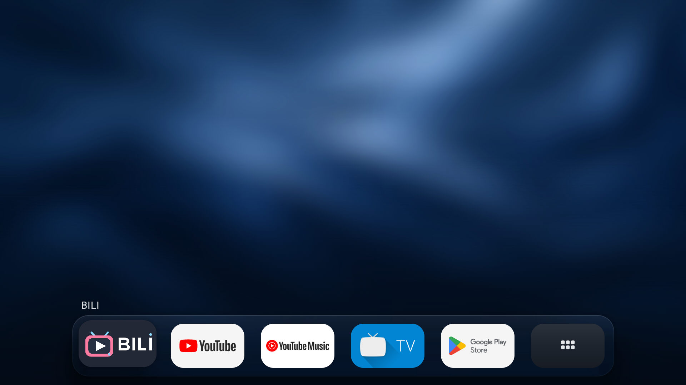
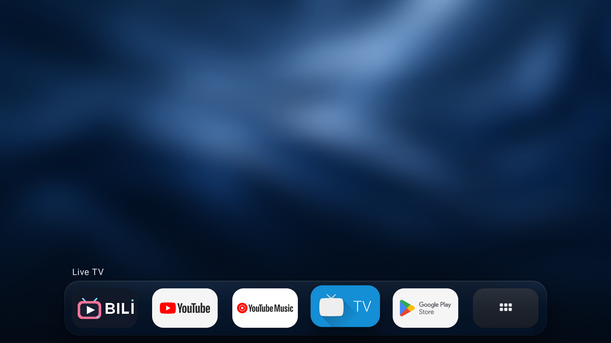
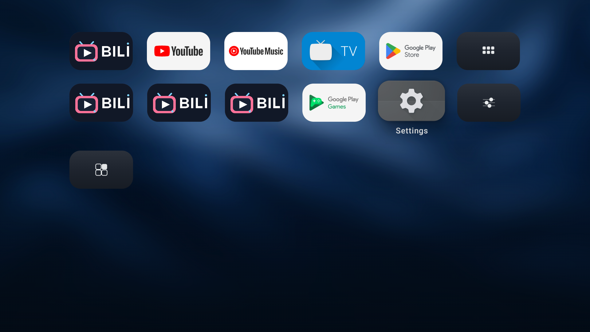

# Luma TV

简洁的中文 Android TV 桌面启动器，以 tvOS 的布局、留白和焦点交互为设计参考。

Kotlin · Jetpack Compose · Android 8.0+ · MIT License

当前为 **0.2.0 早期开发版本**。已在 Android TV 模拟器验证核心遥控器路径，实体电视兼容性与性能仍在完善。

## 界面

首页以高斯模糊的「深蓝丝绸」壁纸为底场，切换应用时不再把应用Logo放大铺满。前五个收藏与“全部应用”以轻悬浮Dock收起在画面底部：整排居中缩窄至原可用宽度的85%，图块底边留24dp安全间距，下方网格完全隐藏。首排保留更通透的圆角磨砂玻璃底板，外扩12dp，壁纸切片以48%不透明度叠加浅色材质和细边缘高光。向下呼出网格时，两排一起平滑升到顶部，玻璃底板同步淡出；收起时一同回到底部并恢复底板。展开约380毫秒、收起约320毫秒，支持中途反向；网格图块分批淡入、轻微上浮，布局列宽和行距不变。背景亮光集中于上半部，下半部渐进压暗；焦点切换带动壁纸轻微视差、展开时略微推近，名称带淡入过渡；开启“减少动态效果”可关闭新增运动。应用图块使用本机真实横幅，缺失时退回图标；只有焦点项显示名称，首排名称固定在托盘左上方，下方网格名称在图块下方。没有标题栏、时钟或卡片描边。







以上是1920×1080模拟器实际运行截图。应用图标和横幅来自设备已安装的应用，壁纸来源见[素材说明](design/assets/ambient-source-v4.md)。左右选择应用、确认启动；背景只是装饰，不接收焦点。没有虚构影视推荐、观看记录或进度。

## 功能

- 发现并启动电视应用，提供没有电视入口的“其他应用”分组。
- 收藏、取消收藏、独立排序、隐藏与恢复，偏好保存在本机。
- 方向键、确认键、返回键完成核心操作，长按确认仅作为管理快捷方式。
- 固定深蓝壁纸、壁纸取色的磨砂托盘、焦点应用名称、首排与网格同步升降、弹簧式焦点缩放，返回后恢复焦点及滚动位置。
- 内置背景、本地图片、亮度、安全边距和减少动态效果；低配设备可以关闭背景模糊。
- 默认桌面状态检测与系统设置引导，始终保留原系统桌面。
- 核心桌面离线可用，无账号、广告、遥测、网络权限或后台常驻服务。

## 构建

需要 **JDK 17**、Android SDK Platform 36 及相应构建工具。最低运行版本 API 26；使用 Gradle Wrapper，首次构建需要下载依赖。

```bash
git clone https://github.com/Yaronluo/Luma-TV.git
cd Luma-TV
./gradlew :app:assembleDebug :app:testDebugUnitTest :app:lintDebug :app:assembleDebugAndroidTest
```

Windows PowerShell 可使用：

```powershell
.\scripts\build.ps1
# 缓存完整后可离线构建
.\scripts\build.ps1 -Offline
```

设置好 `ANDROID_HOME`，或在未跟踪的 `local.properties` 中指定 SDK 位置。Windows 构建脚本使用项目内 `.gradle-user/` 缓存；不要同时运行多个 Gradle 构建。

Debug APK 输出：`app/build/outputs/apk/debug/app-debug.apk`，包名 `io.lumatv.launcher`。使用开发签名，仅用于测试；目前没有正式签名的公开安装包。

## 运行与遥控器

先通过 `adb devices -l` 识别自己的测试模拟器，使用明确的 serial 覆盖安装并按普通应用启动。不要清空或重置已有环境。项目的 `run-emulator.ps1` 和 `test-emulator.ps1` 专门保护维护者已有的 `BILI_TV_API_34` 模拟器，不是通用安装脚本。

- 底部第一排左右浏览，向上保持当前可见应用焦点，向下呼出网格，第一排与网格一起升到顶部。
- 下方网格首行向上或按返回键收起网格，焦点回到第一排，首排与网格同步回到底部。
- “全部应用 → 管理应用”或首页管理图块可以收藏、排序和隐藏。
- 排序模式：方向键移动，确认保存，返回取消。
- 设置页右键进入内容，左键回分类；返回先退出内容区，再回来源页面。
- “设置 → 应用管理 → 已隐藏应用”可恢复显示。
- “设置 → 外观 → 背景模糊”切换清晰背景，选择重启后保持，与“减少动态效果”独立。

没有收藏时使用前五个真实电视应用；有收藏时托盘显示前五个收藏。更多收藏及其余电视应用位于下方网格，不根据使用频率自动重排。

## 默认桌面

安装后先以普通应用使用，HOME 候选入口默认关闭。“设置 → 默认桌面 → 设为默认桌面”会启用候选入口并打开系统允许的角色请求或桌面选择页面。不同电视可能限制切换，角色授予成功也不等于 Home 键已经进入 Luma TV。

切换前记录原桌面组件和恢复方法，保留可用的 ADB 连接与原桌面。在系统桌面选择中重新选择原桌面即可恢复；实际默认桌面为其他应用时，可使用 Luma TV 的“恢复普通应用模式”关闭候选入口。

已验证的 API 34 模拟器存在系统限制：原桌面优先级更高，实际 Home 仍进入原桌面。本项目不禁用原桌面、不使用无障碍拦截来绕过该限制。具体型号需要单独验证。

## 验证与限制

当前改版已完成编译、4项单元测试、覆盖安装与启动，5项相关遥控器回归通过，覆盖展开/收起、中间帧焦点裁切、名称位置、快速方向与确认、设置返回恢复，以及模糊和减少动态效果。完整遥控器套件现有14项，本次未全部重跑；此前完整套件记录见[验证文档](docs/validation.md)。编译、安装、启动和交互是分别记录的验证结果。

实体 TCL / Xiaomi、4K、稳定帧率和长期运行尚未验收。没有内容源、账号、影视聚合、继续观看或云服务；不读取其他应用私有数据。组件名变更时暂不自动迁移收藏，系统低分辨率横幅放大后可能偏软。

- [设计与架构](docs/design.md)
- [验证记录与已知限制](docs/validation.md)
- [设置页截图](docs/screenshots/settings.png)
- [参与开发](CONTRIBUTING.md)

## 许可与素材

项目自有代码采用 [MIT License](LICENSE)。背景源稿及导出脚本位于 `design/`；第三方依赖、应用标识和素材说明见 [THIRD_PARTY_NOTICES.md](THIRD_PARTY_NOTICES.md)。本项目独立开发，与 Apple 及截图中的第三方应用没有隶属关系。
